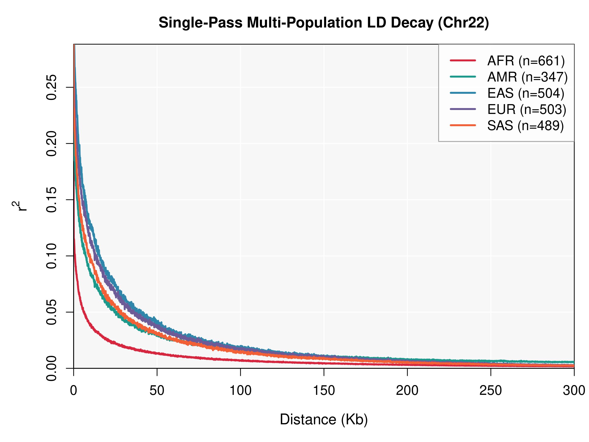

# PopLDdecay2

**Fast, memory-efficient linkage disequilibrium (LD) decay analysis**

[中文](README.cn.md) | [Input and output formats](doc/FORMAT.md) | [Reproduction scripts](RunTest/README.txt)

**Version: v0.80**

PopLDdecay2 calculates LD decay from SNP data. It supports VCF, genotype, and PLINK binary input, population subsets, region restrictions, and parallel computation. For inputs and options supported by [PopLDdecay 3.45](https://github.com/hewm2008/PopLDdecay), it uses the same command-line interface and filters and produces byte-identical data output. On chromosome 22 of 1000 Genomes Phase 3, it was 17.6× faster with one thread and 147× faster with 32 threads, while using roughly half the memory in the single-threaded comparison. See [Performance](#performance) for the benchmark conditions.

If you use PopLDdecay2, please cite its repository for now: [hewm2008/PopLDdecay2](https://github.com/hewm2008/PopLDdecay2).

## Table of contents

- [Installation](#installation)
- [Quick start](#quick-start)
- [Command-line options](#command-line-options)
- [Input](#input)
- [Output](#output)
- [LD decay](#ld-decay)
- [Performance](#performance)
- [Accuracy and compatibility](#accuracy-and-compatibility)
- [Troubleshooting](#troubleshooting)
- [Contact](#contact)

## Installation

On Linux/Unix or macOS, unpack the distribution and build it:

```sh
tar -zxvf PopLDdecay2XXX.tar.gz
cd PopLDdecay2XXX
sh make.sh
./bin/PopLDdecay2 -help
```

The executable is written to `bin/PopLDdecay2`. The build requires a C++17 compiler (GCC 8 or equivalent), htslib, zlib, and pthreads. htslib 1.16 or newer is required; version 1.18 or newer is recommended for speed.

If htslib is installed outside a standard location, specify its prefix, which must contain `include/htslib` and `lib/libhts`:

```sh
sh make.sh HTSLIB_ROOT=/path/to/htslib
# Alternatively, configure directly with CMake:
cmake -S . -B build -DHTSLIB_ROOT=/path/to/htslib
```

On macOS, for example, install htslib with Homebrew and set the prefix:

```sh
brew install htslib
export HTSLIB_ROOT=$(brew --prefix htslib)
sh make.sh
```

Pass build options as `sh make.sh KEY=VALUE`:

| Option | Description |
| --- | --- |
| `HTSLIB_ROOT=<prefix>` | htslib installation prefix. |
| `CXX=<compiler>` | Use the specified compiler instead of the automatically detected compiler. |
| `NATIVE=1` | Enable `-march=native` for potentially faster, machine-specific binaries. A 1-ULP rounding difference at a boundary can cause byte comparisons against golden digests to fail; leave this at `0` when comparing. |
| `LTO=1` | Enable link-time optimization; semantics and output bytes remain unchanged. |
| `KEEP_BUILD=1` | Keep the intermediate `build/` directory. |
| `ENABLE_MPOPCNT=0` | Do not explicitly request the hardware POPCNT instruction. |
| `ENABLE_FP_CONTRACT_OFF=0` | Do not disable floating-point contraction. |

On x86, the default build explicitly requests POPCNT for haplotype counting and disables floating-point contraction so output does not depend on the compiler's default target. The last two switches can be used together to disable these settings; according to the supplied benchmarks they affect speed, not output bytes:

```sh
sh make.sh ENABLE_MPOPCNT=0 ENABLE_FP_CONTRACT_OFF=0
```

## Quick start

### 1. Single population

The package includes a small dataset (50,000 biallelic SNPs, 2,504 samples, 19 MB), so the workflow can be run offline.

```sh
./bin/PopLDdecay2 -InVCF RunTest/00.GetData/base_chr22_50k.vcf.gz \
  -OutStat chr22 -MaxDist 300 -T 8

zcat chr22.stat.gz | head -5
# #Dist  Mean_r^2  Mean_D'  Sum_r^2  Sum_D'  NumberPairs
# 6      0.4153    NA       2.9073   NA      7
# 7      0.8607    NA       3.4428   NA      4

# Plot the result (requires R)
perl bin/Plot_OnePop.pl -inFile chr22.stat.gz -output chr22
```

`Dist` is in base pairs. Distances with no SNP pairs are omitted, and `NA` indicates a column not populated in that output mode.

### 2. Multiple populations

The following example analyzes five populations in a single run. The test script and example files are available in `RunTest/04.Fig3Run`.

```sh
# Two columns: sample<TAB>population (provided in RunTest/04.Fig3Run/sample.group)

./bin/PopLDdecay2 -InVCF RunTest/00.GetData/base_chr22_50k.vcf.gz \
  -SubPop RunTest/04.Fig3Run/sample.group -OutStat mp -T 8
# Produces mp.AFR.stat.gz, mp.AMR.stat.gz, mp.EAS.stat.gz, mp.EUR.stat.gz and mp.SAS.stat.gz

printf 'mp.AFR.stat.gz\tAFR\nmp.AMR.stat.gz\tAMR\nmp.EAS.stat.gz\tEAS\nmp.EUR.stat.gz\tEUR\nmp.SAS.stat.gz\tSAS\n' > pops.list
perl bin/Plot_MultiPop.pl -inList pops.list -output mp
```

Sample names in `-SubPop` must match the input: the VCF `#CHROM` line, the genotype header (`#CHROM POS S1 S2 ...`), or the ID in the PLINK `.fam` file. Missing names generate a warning; duplicates and populations with fewer than three samples produce an error.

Notes: *Users can also customize the colors for different populations using the `-color` option.*

## Command-line options

```text
	Usage: PopLDdecay2 -InVCF <in.vcf.gz> -OutStat <out.stat>

  	-InVCF         <str>    Input SNP VCF
  	-InGenotype    <str>    Input SNP genotype file
  	-InPlink       <str>    Input PLINK binary file prefix (bed+bim+fam)
  	-OutStat       <str>    Output prefix for distance and r^2/D' statistics

  	-SubPop        <str>    Subgroup sample list (repeatable)
  	-MaxDist       <int>    Maximum distance between SNPs in kb [300]
  	-MAF           <float>  Minimum minor allele frequency [0.005]
  	-Het           <float>  Maximum heterozygote ratio [0.88]
  	-Miss          <float>  Maximum missingness ratio [0.25]
  	-EHH           <str>    EHH decay start site [NA]
  	-OutFilterSNP           Output the SNPs retained for calculation
  	-L             <str>    Restrict regions: BED, chr:start-end, or chr
  	-T             <int>    Threads for parallel LD calculation [4]
  	-OutType       <int>    Output type [0-8]; see -help
  	-help                   Show more help
```

Run `./bin/PopLDdecay2 -help` and see [Input and output formats](doc/FORMAT.md) for details. `-L` accepts a BED file (0-based, half-open), `chr:start-end` (1-based, closed), or a chromosome. LD is calculated only between SNPs belonging to the same region.

Numeric arguments are parsed strictly: `-MAF`, `-Het`, and `-Miss` must be finite decimal values in `[0, 1]`; `-MaxDist`, `-OutType`, `-T`, and the coordinate supplied to `-EHH` must be integers. Errors identify the option and supplied value. Boundary values such as `-MAF 0 -Miss 1 -Het 1` are valid. Unlike older behavior, an invalid value such as `-MAF abc` is not silently converted to zero.

## Input

| Input | File or option | Indexed reading |
| --- | --- | --- |
| Uncompressed VCF | `.vcf` | No |
| Ordinary gzip VCF | `.vcf.gz` | No |
| BGZF VCF | `.vcf.gz` | Yes, with `.tbi` or `.csi` |
| Genotype | `-InGenotype`, plain or `.gz` | Not applicable |
| PLINK binary | `-InPlink prefix` for `.bed`, `.bim`, and `.fam` | Not applicable |

Ordinary gzip VCF files can be read quickly but cannot use an index. With `-T > 1`, input reading falls back to sequential reading, although LD calculation remains parallel. For indexed parallel reading, compress and index the VCF with bgzip and tabix:

```sh
bgzip -@ 8 in.vcf && tabix -@ 8 in.vcf.gz
```

For `-InGenotype`, each record starts with `chr<TAB>site<TAB>`, followed by one IUPAC code per sample: `A/C/G/T` for homozygotes, `M/K/Y/R/W/S` for heterozygotes, and `-` or `N` for missing data.

`-InPlink` reads the `.bed`/`.bim`/`.fam` files directly, without conversion. Sample names come from the `.fam` IDs and match the names written to a VCF header by `plink --recode vcf`, so the same `-SubPop` lists can be used.

The input paths differ in ways that matter when comparing results:

| Property | `-InVCF` | `-InGenotype` | `-InPlink` |
| --- | --- | --- | --- |
| Phase | Uses phase in `GT` | Unavailable | `.bed` does not store phase |
| `-MAF` denominator | Number of observed alleles | `2 × number of samples` | Number of observed alleles |
| Byte-identical to PopLDdecay 3.45 | Yes | Yes | 3.45 has no PLINK input |

VCF and PLINK input select the same sites and yield the same pair counts, but r² can differ slightly for phased data because the 2-bit `.bed` format cannot preserve `GT` phase. The average difference was about 0.005 on 1000 Genomes chromosome 22.

## Output

`-OutStat` specifies a **prefix**, not a literal filename. A trailing `.stat.gz` or `.stat` is removed before output names are constructed: `chr22`, `chr22.stat`, and `chr22.stat.gz` all produce `chr22.stat.gz`. With `-SubPop`, each population produces `<prefix>.<label>.stat.gz`.

| Mode | Files produced |
| --- | --- |
| Default (`-OutType 1`) | `<prefix>.stat.gz`: mean r² binned by distance |
| `-OutType 2` | `<prefix>.stat.gz`: summaries of r² and D' |
| `-OutType 3`, `6`, `7`, or `8` | Statistics plus pairwise LD values in `<prefix>.LD.gz` |
| `-OutType 4` or `5` | Histogram-style statistics for distribution plots |
| `-EHH chr:site` | `<prefix>.ehh.gz`; also `<prefix>.ehh.pdf` and `<prefix>.ehh.png` if `Rscript` is available |
| `-OutFilterSNP` | Retained sites: `<prefix>.vcf.filter.gz`, `<prefix>.genotype.filter.gz`, or `<prefix>.plink.filter.bim`, depending on input |

**Existing statistics files are truncated at startup.** The program opens `<prefix>.stat.gz` for writing to check that it is writable, even if a later input error stops the run. Population-specific statistics files are treated the same way. This intentionally matches PopLDdecay 3.45. Use a different prefix to preserve previous results. Other files, including `.LD.gz`, `.ehh.gz`, and filtered-site files, are written only when the corresponding feature is enabled; a write failure does not leave a partial file.

### Runtime messages

Progress and run details go to stderr, for example:

```text
[PopLDdecay2] input VCF /path/base_chr22_50k.vcf.gz (indexed)
[PopLDdecay2] filters MAF=0.005 Het=0.88 Miss=0.25 MaxDist=300kb
[PopLDdecay2] threads=8 groups=1 (all samples)
[PopLDdecay2] output chr22.stat.gz
[PopLDdecay2] sites read=52469 kept=52469 (indel=0 multiallelic=0 filters=0)
[PopLDdecay2] wrote chr22.stat.gz
```

Stdout retains the legacy message:

```text
Used [perl  ../bin/Plot_XX.pl ] to Plot the LDdecay
```

During long LD calculations, a progress line is added every five minutes with chromosome, pair count, and elapsed time:

```text
[PopLDdecay2] 22 pairs=19494095 elapsed=300s
```

## LD decay

LD decay describes how allelic correlation between two sites declines with physical distance. For each pair of SNPs within the window, PopLDdecay2 calculates r² (and, when requested, normalized D') and bins results by distance:

```text
r²(i,j) = (P(Ai*Aj) - P(Ai)*P(Aj))² /
          (P(Ai)*(1-P(Ai)) * P(Aj)*(1-P(Aj)))
```

The curve reflects the recombination experienced by a population and informs population structure analysis, LD-based relatedness estimation, and association study design. The example below shows five 1000 Genomes superpopulations analyzed in one pass through one file (`RunTest/04.Fig3Run`).



## Performance

The following benchmark used phased 1000 Genomes Phase 3 chromosome 22 data (2,504 samples, 1,103,547 records, bgzip compressed with a `.tbi` index), `-MaxDist 300 -MAF 0.005`, and a shared 80-core RHEL 9 x86-64 node.

| Tool | Threads | Wall time | Peak RSS | Speedup vs 3.45 | Byte comparison |
| --- | ---: | ---: | ---: | ---: | --- |
| PopLDdecay 3.45 | 1 | 3339 s | 1066 MB | 1.0× | Reference |
| PopLDdecay2 | 1 | 189 s | 547 MB | 17.6× | diff = 0 |
| PopLDdecay2 | 16 | 33 s | 714 MB | 102× | diff = 0 |
| PopLDdecay2 | 32 | 23 s | 878 MB | 147× | diff = 0 |

These are the numbers reported in the paper; other jobs were running on the node during measurement. The v0.80 kernel is approximately twice as fast as the version measured. Of the 1,103,547 records, 217,103 entered LD calculation: 44,030 indels and 7,835 multiallelic records were skipped, and `-MAF 0.005` removed approximately 80% of the remainder.

The main optimizations are:

- **2-bit genotypes:** pack haplotypes into bits and use popcount to build the 2×2 table for each pair.
- **One popcount per word:** when neither site has missing data, derive the table from one popcount per word and per-site allele counts. In the 1000 Genomes data, 96% of sites had no missing data.
- **Parallel indexed reading:** distribute contigs of a tabix-indexed bgzip VCF to workers; a single chromosome is split into overlapping position shards so reading and calculation can overlap.
- **Hardware popcount:** request POPCNT at build time; the hardware implementation was 3.4× faster than software generated for a strict x86-64 target.

`-T` enables parallel reading and pair calculation when there is enough work: parallel reading requires a `tabix` index, and distributing pairs requires more threads than contigs. Memory use grows with `-MaxDist` (distance bins) and `-T` (one set of bins per worker). Pairwise output modes (`-OutType 3/6/7/8`) instead require additional disk space.

## Accuracy and compatibility

`RunTest/08.Accuracy` compares 3,590 pairs within 300 kb from the first 100 sites with MAF ≥ 0.1 in the 50k subset (2,504 phased samples). The reference is direct counting of phased haplotypes in the VCF; PLINK 2.0 and Haploview 4.2 are also compared.

| Tool | Pearson correlation of r² with reference | Mean absolute difference | Maximum absolute difference |
| --- | ---: | ---: | ---: |
| PopLDdecay2 | 1.000000 | 0.000025 | 0.000050 |
| Haploview 4.2 | 0.999999 | 0.000238 | 0.000500 |
| PLINK 2.0 | 0.979098 | 0.020092 | 0.521827 |

PopLDdecay2 and Haploview produce the same r² values apart from printed precision, and both agree with the reference. PLINK 1.9 and 2.0 agree with each other but differ from this reference: they re-estimate haplotype frequencies from diploid genotypes rather than use the phase already in the VCF. `RunTest/08.Accuracy/step4a` tests this directly: PLINK gives identical values for phased and unphased versions of the same sites, while PopLDdecay2 uses phase.

For the same input and parameters, data output for the input modes shared with PopLDdecay 3.45 can be compared byte for byte:

```sh
OLD=/path/to/PopLDdecay-3.45/bin/PopLDdecay 
bash RunTest/06.Verify/golden_diff.sh
```

The CI checks require neither the old binary nor a download:

```sh
bash RunTest/06.Verify/step1_checkOutput.sh
```

They cover 108 cases: 88 output digests, 17 behavioral assertions, and 3 documentation checks.

## Troubleshooting

| Problem | What to check |
| --- | --- |
| Build reports `htslib not found` | Install htslib and set `HTSLIB_ROOT` to the prefix containing `include/htslib` and `lib/libhts`. |
| Build reports `htslib 1.16 or newer is required` | Upgrade htslib; 1.18 or newer is faster. |
| VCF reading remains sequential with `-T > 1` | Ordinary gzip cannot be indexed. Use bgzip and tabix as shown in [Input](#input). |
| A `-SubPop` sample cannot be found | Match names exactly to the VCF header, genotype header, or PLINK `.fam` ID. |
| PLINK and VCF input give different r² values | PLINK `.bed` stores genotypes rather than phase; phased input can therefore give different results. |
| Pairwise LD values are needed | Use `-OutType 3`, `6`, `7`, or `8`; see [format documentation](doc/FORMAT.md) for column definitions. |
| A numeric option is rejected | Check the strict numeric requirements in [Command-line options](#command-line-options). |

## Contact

- Email: hewm2008@gmail.com / hewm2008@qq.com ([project](https://github.com/hewm2008/PopLDdecay))
- QQ group: 125293663
